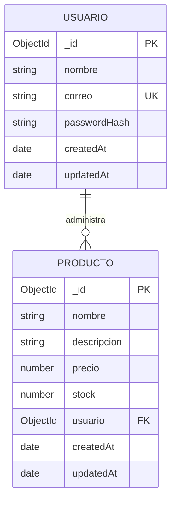

# Diagrama entidad-relación — TaskFlow Inventario

## Descripción de la relación

Un usuario puede registrar cero o muchos productos.

Cada producto pertenece a un único usuario.

El campo `usuario` del modelo Producto almacena
el ObjectId del usuario propietario.

La aplicación utiliza esa referencia para restringir
la consulta, actualización y eliminación de productos.
